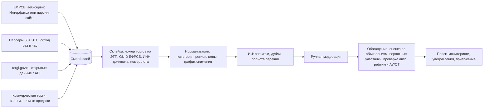

# Конкурентный анализ: TBankrot и рынок агрегаторов торгов

> **Цель проекта:** агрегатор торгов по типу TBankrot, но только для автомобилей и спецтехники.
> **Дата исследования:** 26.10.2026.
> **Метод:** веб-поиск. Прямого доступа к сайтам из рабочего окружения не было (см. раздел 8 «Ограничения»).

Обозначения достоверности:

- **[Ф]** — факт из независимого или официального источника;
- **[З]** — заявление самой компании (маркетинг, не проверено);
- **[В]** — мой вывод или реконструкция, требует проверки.

---

## 0. Коротко

1. **TBankrot — небольшой прибыльный нишевый бизнес из Ижевска.** Сайтом управляет ООО «Интернет-Компания Парус» (с 2012 г.). Компанией на 100% владеет её гендиректор А. М. Козлов. Выручка около 43 млн ₽ в год: в 2023 г. 42,9 млн при прибыли 9,8 млн, в 2025 г. 43,5 млн. В штате 45 человек. Трафик 200–250 тыс. визитов в месяц, средняя сессия около 18 минут. Аудитория — профессионалы, которые проводят в сервисе много времени.
2. **Как они получают данные.** Основа — ЕФРСБ (Федресурс). Площадки (ЭТП) обязаны передавать туда структурированные сообщения о ходе торгов. Эти данные можно забирать двумя способами: через платный веб-сервис оператора ЕФРСБ, АО «Интерфакс» (SOAP с 2013 г., REST с 15.04.2024), или парсингом публичного сайта. Кроме этого, TBankrot **раз в час обходит 50+ ЭТП** [З]. С площадок он берёт фото, документы, текущую цену публичного предложения и лоты, которые не находятся поиском ЕФРСБ. Арестованное и муниципальное имущество он берёт с torgi.gov.ru. Затем ИИ исправляет опечатки и убирает дубли, а модераторы проверяют результат вручную [З].
3. **Писать все парсеры сразу необязательно.** Готовые фиды продают «Банкротный шпион» (полная база по API за 25 000 ₽/мес) и «Гевея» (6,22 ₽ за лот без фото или 17,30 ₽ с фото и файлами).
4. **Техника — самая массовая категория в банкротстве.** В 2023 г. транспорт был на первом месте по числу сделок: 24 тыс. из 72,2 тыс. Спецтехника в 2024 г. собрала больше всего участников торгов на Portal DA (Сбер).
5. **Второй большой источник — изъятая лизинговая техника.** В 2025 г. в стоках лизинговых компаний был рекорд около 30 тыс. единиц, по оценкам 2025–2026 гг. — уже 50–60 тыс. Около 44% из них — грузовики, около 14% — спецтехника. **Единого агрегатора для этой техники нет.** Ближе всего ЛизингСток (около 33,6 тыс. предложений). У TBankrot такого источника по сути нет.
6. **На что жалуются пользователи TBankrot:**
   - платный доступ уже на входе («сразу требуют 1500… чтоб просто смотреть»);
   - «фейковые» и неактуальные объявления;
   - поиск «часто не работает»;
   - приложение зависает или не открывается, дизайн устарел;
   - поддержка не отвечает;
   - данные о публичном предложении приходят с опозданием.
7. **Главная возможность** — сделать вертикальный «Авто.ру для техники с торгов». В одной выдаче собираются банкротные торги, арест и конфискат, лизинговые стоки и залоги банков. У каждого лота есть структурированные параметры: марка, модель, год, VIN, пробег, моточасы. В карточке сразу видны проверка VIN и рыночная оценка («скидка от рынка сейчас»). Сервис сопровождает сделку: участие через агента без ЭЦП, осмотр, логистика, постановка на учёт.

---

## 1. Профиль TBankrot

### 1.1 Компания

| Параметр | Значение | Дост. |
|---|---|---|
| Бренд и сайт | TBankrot, tbankrot.ru | Ф |
| Оператор сайта | ООО «Интернет-Компания Парус». ИНН 1831153390, ОГРН 1121831002589. Зарегистрировано 14.05.2012 в Ижевске. ОКВЭД: создание и использование баз данных | Ф |
| Владелец | Козлов Алексей Михайлович: 100% долей и гендиректор «Паруса» и ООО «Тбанкрот.Ру» | Ф |
| Второе юрлицо | ООО «Тбанкрот.Ру». ИНН 1840100394, зарегистрировано 02.11.2020. Выручка около 3,7 млн ₽ (2025) | Ф |
| Выручка «Паруса» | 21,0 млн ₽ (2021); 42,9 млн ₽ (2023, чистая прибыль 9,8 млн); 43,5 млн ₽ (2025) | Ф (агрегаторы ЕГРЮЛ и отчётности) |
| Штат | 45 человек (2025) | Ф |
| Реестр российского ПО | Есть, запись № 19366 (по данным Soware) | Ф |
| Трафик | Около 209 тыс. визитов в июле 2025 г., 250 тыс. в августе, 201 тыс. в сентябре. Средняя сессия 18:36. Аудитория: РФ, затем Украина и Германия | Ф (оценка Semrush) |
| Каналы | Приложение iOS (3,9★, 275 оценок), Android в RuStore (2,8★, 12 оценок), Telegram @tbankrot_official (около 26,6 тыс. подписчиков), YouTube, VK, X, вебинары | Ф |

**Грубая оценка числа платящих [В].** Выручка около 43 млн ₽, годовой тариф стоит 12,6–48,6 тыс. ₽. Значит, платящих примерно 1–3,5 тыс., если пересчитать на годовые подписки и не учитывать агентские услуги. Рынок платной подписки на агрегаторы небольшой. Больше денег в нише приносят, скорее всего, сделки (сопровождение покупки), а не подписка.

### 1.2 Продукт

TBankrot называет себя так: «не просто агрегатор, а платформа для работы на торгах» [З]. Типы торгов в сервисе: банкротство, арестованное, залоговое, коммерческое и муниципальное имущество, прямые продажи [З].

**Заявленная база [З].** Более 6,5 млн лотов с 2010 г. Источники — ЕФРСБ и 50+ ЭТП. Более 2 000 новых лотов в день. В более старом описании было «500+ новых лотов и смена статуса 3 000+ лотов ежедневно». Счётчики категорий на сайте: около 26 тыс. лотов «Автомобиль» и около 21,5 тыс. «Транспорт». Неясно, считаются ли в них только активные лоты или архив тоже.

**Функции** (по данным сайта, магазинов приложений и Telegram-канала):

- Поиск и фильтры. Фильтры можно сохранить как мониторинг с уведомлениями на почту и в мессенджеры. Есть поиск и мониторинг по области на карте.
- Избранное с папками, экспорт.
- Карточка лота содержит:
  - сообщения о торгах из ЕФРСБ и ключевые даты;
  - сведения о должнике, арбитражном управляющем (АУ) и организаторе торгов (ОТ);
  - фото, отчёты об оценке, документы;
  - для автомобилей — данные о владельцах, ДТП, ограничениях и розыске.
- По словам сервиса, «ИИ проверяет лоты на ошибки, опечатки, полноту перечня и исправляет их», а затем «модераторы вручную перепроверяют» [З].
- AI-инструменты [З]:
  - индекс привлекательности лота по шкале 1–10 и сортировка по нему;
  - рыночная оценка недвижимости и авто «по живым объявлениям»;
  - прогноз до 10 вероятных участников торгов с вероятностью участия.
- Калькуляторы доходности и рентабельности, аналитика итогов торгов, история изменений лота.
- Рейтинги и отзывы об АУ и ОТ, оценка ОТ прямо в карточке, шаблоны официальных запросов к АУ и ОТ.
- Участие в торгах без ЭЦП через агента: 4 500 ₽ за участие, «никаких дополнительных комиссий» [З].
- Обучение: вебинары для новичков, статьи, YouTube-канал.

### 1.3 Тарифы

Часть цен взята из поисковых выдержек, их нужно сверить на сайте.

| Тариф | Цена | Что входит |
|---|---|---|
| Бесплатный | 0 ₽ | Базовый поиск. Нет избранного и прямой ссылки на ЭТП в карточке |
| Бизнес | 1 500 ₽/мес. За 12 мес — 12 600 ₽ вместо 18 000 ₽. Цена за одного пользователя | Полный поиск, мониторинг, прямая ссылка на ЭТП. Пробный период 7 дней |
| Профи | 8 850 ₽ за 3 мес, 15 300 ₽ за 6 мес, около 25 800 ₽ за год (по каталогам) | Добавляются аналитика, прямая связь с ОТ, отчёты, юридическая помощь |
| Премиум | 48 600 ₽ за 12 мес вместо 69 600 ₽ | Всё из «Профи», плюс аналитика на карте, AI-инструменты, расширенная аналитика, история изменений лота |
| Агент без ЭЦП | 4 500 ₽ за участие | Подача заявки и участие в торгах от имени клиента |

---

## 2. Как TBankrot и рынок получают данные

### 2.1 Почему данные вообще лежат в открытом виде

- Все сообщения о торгах в банкротстве (объявления, результаты и др.) обязательно публикуются в **ЕФРСБ** (bankrot.fedresurs.ru). Реестр ведёт АО «Интерфакс» по поручению Минэкономразвития [Ф].
- Сами торги проходят на аккредитованных **ЭТП**. В разные периоды активны 45–56 площадок. Порядок проведения торгов задаёт приказ Минэкономразвития № 495 от 23.07.2015, последняя редакция — от 29.10.2025 [Ф].
- ЭТП передают в ЕФРСБ **машиночитаемые сообщения о ходе торгов** через «Сервис получения данных от электронных площадок» (спецификация Service_ETP v2.44) [Ф]:
  - `SetBiddingInvitation` — торги объявлены;
  - `SetBiddingStart` — торги идут; `ApplicationSessionStatistic` — сведения о ходе торгов;
  - `SetBiddingResult` — торги завершены;
  - `SetBiddingCancel` — торги отменены; `BiddingFail` — торги не состоялись.

  Вторичный источник указывает срок передачи — не позднее 1 часа после появления сведений на площадке (гл. VIII приказа № 495). **Это нужно сверить с текстом приказа.**
- Информационные сообщения о продаже **арестованного имущества** (ФССП → Росимущество) обязательно размещаются на **torgi.gov.ru** [Ф]. Там же публикуются конфискат, приватизация и муниципальное имущество.

**Вывод.** Основные данные уже собраны государством в ЕФРСБ и ГИС «Торги». Агрегаторы зарабатывают на том, что склеивают эти данные, чистят их, дополняют и удобно показывают.

### 2.2 Источники и способы доступа

**ЕФРСБ — официальный веб-сервис**

- **Что даёт:** опубликованные сообщения (в том числе объявления о торгах и результаты), отчёты АУ, сообщения ЭТП о ходе торгов, реестры АУ, СРО, ОТ и должников.
- **SOAP.** «Сервис передачи реестров, торгов, отчётов АУ и опубликованных сообщений», версия 1.47. Работает с 2013 г. Методы: `GetTradeMessages`, `GetTradeMessagesByTrade`, `GetTradeMessageContent`.
- **REST API.** Работает с 15.04.2024, текущая версия 1.3.0 от 29.10.2025. Методы описаны в swagger:
  - `v1/auth` — выдаёт Bearer-токен на 8 часов;
  - `v1/messages` — фильтры по периоду, типу сообщения, должнику, номеру или GUID;
  - `v1/trade-messages` — сообщения ЭТП; фильтры по номеру торгов, GUID площадки и GUID должника.
- **Условия:** нужен договор с АО «Интерфакс», доступ платный. Публичного прайса я не нашёл. Слабый ориентир: соседний сервис ЕФРСФДЮЛ стоит около 9 тыс. ₽/мес по сообщению с форума, это не официальные данные.
- **Подводные камни:** сообщения приходят в XML в том виде, в каком их подписали. Часть важных параметров лота (график снижения цены, состав лота) записана свободным текстом.

**ЕФРСБ — публичный сайт**

- **Как забирать:** сайт работает как SPA с внутренним JSON-бэкендом (`fedresurs.ru/backend/...`), данные можно парсить. Бесплатно.
- **Ограничения:**
  - уже при 8 параллельных запросах сайт отвечает ошибками 429/451, поэтому на практике запросы идут по одному с паузой около 2 секунд;
  - поиск отдаёт не больше 1 000 записей (20 страниц) на один запрос;
  - внутренние маршруты меняются вместе с фронтендом.

**ЭТП (45–56 площадок)**

- **Что даёт:** фото, документы, текущую цену и график публичного предложения, статусы, заявки.
- **Как забирать:** нужен отдельный парсер для каждой площадки (HTML или её внутренние JSON-запросы). Публичных API у крупных ЭТП я не нашёл. Каталог РАД, судя по адресам вида `index.php?dispatch=...`, построен на CS-Cart [В].
- **Стоимость:** бесплатно, платим только за разработку.
- **Подводные камни:** у десятков площадок разная вёрстка. Но на топ-5 ЭТП приходится 67–70% торгов, а на топ-10 — 81% (данные Федресурса). С них и стоит начинать.

**torgi.gov.ru (ГИС «Торги»)**

- **Что даёт:** продажи арестованного имущества ФССП, конфиската, приватизация, муниципальное имущество и т. п.
- **Как забирать:**
  - раздел «Открытые данные»: бесплатно, без договора, использовать **можно и в коммерческих целях**; выгрузки в XML с фильтрами по виду торгов и датам;
  - JSON API, на котором работает сам сайт (`/new/api/public/lotcards/search`, статусы `SUCCEED`, `FAILED`, `CANCELED`, `DETERMINING_WINNER`), — неофициальный способ.
- **Подводные камни:** документация к открытым данным устарела, сайт бывает недоступен (ошибки 503, сбросы соединения).

**Маркетплейс Росимущества** (fiol.rosim.gov.ru)

- **Что даёт:** арестованное имущество, в том числе продажи без торгов (на комиссионных началах).
- **Как забирать:** только парсинг, описанного API нет. Бесплатно.

**Залоги банков**

- **Что даёт:** залоговые автомобили и спецтехнику.
- **Где брать:**
  - Portal DA (Сбер): интегрирован с 16 ЭТП, есть лоты лизинговых компаний;
  - залоговый раздел РАД `zalog.lot-online.ru`;
  - сайты банков.
- **Подводные камни:** данные разбросаны по разным сайтам.

**Лизинговые стоки**

- **Что даёт:** изъятую технику.
- **Где брать:**
  - сайты лизингодателей, их витрины на Авито и в Telegram;
  - хабы лизинговых компаний;
  - агрегатор ЛизингСток.
- **Как забирать:** договариваться о партнёрстве или парсить.
- **Подводные камни:** нет единого стандарта и общего реестра.

**ФНС «Витрина имущества банкротов»** (маркетплейс на kartoteka.ru)

- **Что даёт:** имущество банкротов, по которым кредитором выступает ФНС, в том числе транспорт. Сервис сам подтягивает данные из Росреестра, ГИБДД и ЕФРСБ.
- **Как забирать:** парсинг. Бесплатно.
- **Подводные камни:** сервис новый, регионы подключаются постепенно.

**«Коммерсантъ»** (официальное издание для сведений о банкротстве)

- Дублирует ЕФРСБ, подписка около 5 760 ₽ в год. Если есть доступ к ЕФРСБ, этот источник не нужен.

**Готовые фиды агрегаторов**

- **Что даёт:** уже склеенную базу лотов.
- **Варианты:**
  - «Банкротный шпион»: полная база по API с ежедневным обновлением, 25 000 ₽/мес;
  - «Гевея»: API по агентскому договору, 6,22 ₽ за лот без фото или 17,30 ₽ с фото и файлами;
  - небольшие API к ЕФРСБ: api-assist, parser-api, checko, apiportal.
- **Подводные камни:** мы зависим от чужого качества данных и чужого уровня сервиса.

### 2.3 Реконструкция пайплайна TBankrot

TBankrot сам говорит о своих данных следующее [З]:

- «добавление новых лотов осуществляется каждый час со всех аккредитованных ЭТП; также информация подгружается с сайта ЕФРСБ»;
- «TBankrot исправляет опечатки, неточности и дубли»;
- «ИИ проверяет… модераторы вручную перепроверяют»;
- «данные о возможных участниках обновляются в пределах часа после появления лота».

Схема ниже — моя реконструкция на основе этих слов [В].

**Почему нужны и ЕФРСБ, и ЭТП [Ф].** Поиск ЕФРСБ находит не все лоты. Арбитражный управляющий не обязан создавать «карточку торгов». По данным 2019 г., её не было примерно у 5,26% лотов. Кроме того, в описаниях бывают опечатки и неверные категории. На ЭТП же нет единого формата, и лот не всегда можно связать с должником. Вероятных участников TBankrot, скорее всего, вычисляет по историческим протоколам торгов: кто подавал заявки на похожие лоты [В].

### 2.4 Что это значит для нас

- **Минимальный набор источников [В].** Для MVP достаточно трёх:
  - официальный REST ЕФРСБ (с юридической точки зрения надёжнее парсинга);
  - открытые данные torgi.gov.ru;
  - парсеры топ-10 ЭТП (около 81% торгов).

  Остальные площадки можно подключить позже.
- **Быстрый старт [В].** На первые месяцы можно купить фид у «Гевеи» или «Банкротного шпиона», отбирать технику на своей стороне и параллельно писать собственные коннекторы.
- **Главная техническая задача для вертикали** — не парсинг, а разбор свободного текста лота в структуру:
  - определить, является ли лот транспортным средством;
  - извлечь марку, модель, год, VIN, пробег, моточасы, госномер;
  - разобрать лоты-пулы («20 единиц техники одним лотом»);
  - склеить одну и ту же машину между ЕФРСБ, ЭТП и повторными торгами.
- **Риски парсинга [Ф+В].** В РФ нет прямого судебного прецедента ни за парсинг, ни против. Дело «ВКонтакте» против Double Data (А40-18827/2017) закончилось мировым соглашением в 2022 г. При этом суды признавали за владельцем базы данных право изготовителя БД (ст. 1334 ГК РФ). Отсюда правила для работы с ЭТП и ЕФРСБ:
  - соблюдать ограничения по частоте запросов;
  - не выкачивать «существенную часть» базы одной площадки целиком;
  - по возможности договариваться с площадками.

  ФИО должников-физлиц — персональные данные (152-ФЗ). Показывать их нужно по минимуму, а для автомобилей они и не нужны.

---

## 3. Конкуренты и аналоги

### 3.1 Общие агрегаторы торгов

**TBankrot** (tbankrot.ru)
- Модель и цены: бесплатный тариф плюс подписка 12,6–48,6 тыс. ₽ в год; агент 4 500 ₽.
- Особенности: самый функциональный сервис на рынке — AI-индекс, прогноз вероятных участников, рейтинги АУ и ОТ.
- Авто и техника: проверка авто в карточке, около 26 тыс. лотов «Автомобиль».

**Торги России** (торги-россии.рф)
- Модель и цены: базовый поиск бесплатный, платные «Избранное» и другие функции; по отзывам — около 999 ₽/мес.
- Особенности: «24 000+ актуальных лотов со всех ЭТП»; банкротство, арест, залоги, муниципальное имущество; RuStore 3,6★.
- Авто и техника: есть разделы легкового транспорта и спецтехники (на момент индексации — около 393 лотов спецтехники).

**ПроБанкрот** (probankrot.ru)
- Модель и цены: около 4 490 ₽ в год (старые данные); по обзорам, «на ~500 ₽/мес дешевле TBankrot».
- Особенности: повторяет функции TBankrot; отзыв 2023 г.: «очень не информативный».

**Гевея** (heveya.ru)
- Модель и цены: бесплатная витрина; продаёт доступ по API; есть услуги брокеров.
- Особенности: 44 ЭТП; арест, залоги, муниципальное имущество, конфискат, непрофильные активы банков и лизинговых компаний.
- Авто и техника: разделы легковых автомобилей и спецтехники.

**Банкротный шпион** (bankrot-spy.ru)
- Модель и цены: около 7 900 ₽ в год за тариф VIP (старые данные); API — 25 000 ₽/мес.
- Особенности: сравнение цены на торгах с открытым рынком, экспорт в Excel, аналитика по организаторам и победителям.
- Авто и техника: категории «автомобили» и «спецтехника».

**RuTorgi** (rutorgi.com)
- Модель и цены: бесплатно.
- Особенности: по разным данным, 47–62 площадки.
- Авто и техника: раздел «Автомобили» с разбивкой по регионам.

**БАИДС** (baids.ru, Тюмень)
- Модель и цены: тарифы чуть ниже, чем у лидера; участие без ЭЦП — 3 000 ₽.
- Особенности: поиск по кадастровым кварталам.
- Авто и техника: каталог «Спецтехника и транспорт», в том числе лизинговая техника.

**БанкротБаза** (bankrotbaza.ru)
- Особенности: «роботы несколько раз в день просматривают открытые площадки».
- Авто и техника: раздел автомобилей (Москва).

**finderlot.ru**
- Авто и техника: на сайте счётчики «легковые — 13 595», «грузовые и спецтехника — 4 555» лотов; дата подсчёта неизвестна.

**Контур.Закупки**
- Модель и цены: подписка Контура.
- Особенности: вкладка «Торги имущества», сохранённые поиски с оповещениями раз в 15 минут.
- Авто и техника: общий поиск, без отдельной специализации.

**Portal DA** (Сбер)
- Модель и цены: бесплатно; есть агент и кредитование.
- Особенности: залоги и непрофильные активы банков, госструктур и лизинговых компаний; интеграция с 16 ЭТП.
- Авто и техника: есть.

**ФНС «Витрина имущества банкротов»**
- Модель и цены: бесплатно, государственный сервис.
- Авто и техника: есть транспорт.

**Lot Bankrot** (arbbitlot.ru)
- Модель и цены: участие бесплатное, комиссия только при победе («плата за результат»).

### 3.2 Нишевые игроки: авто и техника

**ScanLot** (scanlot.ru)
- Что делает: «доска объявлений» только для автомобилей с банкротных торгов. Автоматически собирает лоты со всех ЭТП и убирает дубли. В карточке есть марка, модель, год, пробег, двигатель, привод, кузов. Брокеры подают заявку и общаются с АУ за покупателя.
- Что это значит для нас: **прямой аналог идеи** для легковых машин. Ареста, лизинговых стоков и спецтехники у него, судя по найденному, нет.

**ЛизингСток** (leasing-stock.ru)
- Что делает: собирает изъятую, арестованную и конфискованную технику «от всех лизинговых компаний». Около 33,6 тыс. предложений, из них около 12 тыс. легковых. Продаёт за наличные и в лизинг.
- Что это значит для нас: прямой аналог по лизинговым стокам, но без банкротных торгов.

**Лизинговые хабы**
- Что делает: «Альфа-Лизинг» открыл хабы в Москве и Санкт-Петербурге. «Газпромбанк Автолизинг» открыл стоянку на 300 мест в Ростове-на-Дону и планирует площадки в Москве и Санкт-Петербурге. Скидки — 5–40%.
- Что это значит для нас: возможные **поставщики лотов и платящие клиенты**, потому что им нужно быстро распродать сток.

**Авито**
- Что делает: лизингодатели (ПСБ Лизинг, ВТБ Лизинг, РЕСО и др.) ведут там собственные страницы. Единого раздела для изъятой техники нет.
- Что это значит для нас: сильный канал трафика, но торги там никак не выделены.

**B2B-аукционы** (например, auto-torgi.ru)
- Что делает: онлайн-аукционы для дилеров. Продают машины лизинговые и каршеринговые компании, страховщики. Средняя скидка около 17–22%.
- Что это значит для нас: смежный рынок перекупщиков и дилеров.

**Telegram-каналы**
- Что делает: публикуют подборки лотов, такой канал ведёт и сам TBankrot.
- Что это значит для нас: важный канал для уведомлений.

### 3.3 Незанятая ниша

Ни один из найденных сервисов не собирает в одной выдаче всё сразу именно по технике:

- банкротные торги, арест и конфискат, лизинговые стоки, залоги банков;
- структурированные параметры машины;
- проверку VIN;
- оценку «скидка от рынка на сегодня»;
- сопровождение сделки до постановки на учёт.

По функциям ближе всех TBankrot. Но он охватывает все виды имущества (недвижимость, землю, дебиторку), берёт дорого уже за просмотр, а лизинговых стоков у него нет.

---

## 4. Что не нравится пользователям TBankrot

Отзывов немного: 12 оценок в RuStore, 275 в App Store, 30 на yareviews. На независимых площадках оценка неплохая (4,4 из 5 на yareviews), профессионалы называют сервис «лидером среди агрегаторов». Тем не менее одни и те же претензии повторяются.

**Пейвол и цена**
- Цитаты: «сразу требуют 1500… чтоб просто смотреть фэйковые обявления»; «довольно дорогая подписка» (2021); «цены завышены» (2019). Конкуренты рекламируют себя как «дешевле TBankrot».
- Источники: RuStore, App Store, yareviews, обзоры агрегаторов.

**Неактуальные данные**
- «Фейковые объявления» — вероятно, имеются в виду завершённые или неактуальные лоты [В].
- По обзорам, «информация о публичных предложениях приходит не всегда оперативно».
- Мониторинг не показывал новые лоты по выходным — сервис сам признал это в своём Telegram-канале.
- Источники: RuStore, обзоры, Telegram TBankrot.

**Поиск**
- «Поисковик часто не работает»; поиск по кадастровому кварталу выдаёт нерелевантные лоты; «хотелось бы более удобные фильтры».
- Источники: RuStore, блог Соснякова, mwm.ai.

**Стабильность приложения**
- «Последние 3 дня вообще не открывается»; «иногда зависает при открытии»; «есть баги». После обновления не работали папки в избранном и пропадал экспорт.
- Источники: RuStore, mwm.ai, Telegram.

**Интерфейс**
- «Устаревший дизайн»; в 2021 г. не было поиска по карте (позже его добавили).
- Источник: App Store.

**Поддержка**
- «Поддержка не отвечает вообще».
- Источник: RuStore.

**Аналитика**
- Автор одного из обзоров пишет, что TBankrot «не помог с аналитикой».
- Источник: обзор агрегаторов.

**Общие претензии ко всем агрегаторам:**
- их данные не имеют юридической силы, условия лота нужно сверять с ЕФРСБ и ЭТП;
- синхронизация запаздывает;
- на этапе публичного предложения перекупщики с роботами успевают раньше обычных покупателей.

---

## 5. Проблемы покупателя техники на торгах и как их решить продуктом

**Не сняты аресты и запреты по VIN**
- Масштаб: по оценке эксперта (2021), «в 80% случаев» автомобиль на банкротных торгах находится под арестом. Встречаются запреты по 8 и более исполнительным производствам.
- Решение: проверка VIN прямо в карточке (ГИБДД, ФССП, реестр залогов ФНП), плюс инструкция или услуга по снятию запретов.

**Нет ПТС, СТС или ключей, машина разукомплектована**
- Масштаб: «Должники часто не отдают документы». Покупатели рассказывают, как приезжали забирать машину и обнаруживали, что она разукомплектована.
- Решение: пометки в карточке (извлекаем из текста лота и документов), запрос к АУ по шаблону, услуга осмотра.

**Сложности с регистрацией в ГИБДД**
- Масштаб: инспекция требует, например, оригинал решения суда о банкротстве прежнего владельца.
- Решение: чек-лист документов для каждого типа торгов, юридическое сопровождение.

**Машину нельзя осмотреть, она далеко**
- Решение: выездной осмотр и диагностика силами партнёров; калькулятор логистики (эвакуатор, трал для спецтехники).

**ЭЦП, аккредитация на каждой ЭТП, задаток**
- Масштаб: ЭЦП стоит до ~30 тыс. ₽ (оценка TBankrot), задаток — до 20% от цены.
- Решение: участие через агента без ЭЦП. На рынке это стоит 3 000–4 500 ₽ за участие или процент при победе.

**Выгодная цена на публичном предложении быстро уходит**
- Масштаб: большая часть имущества продаётся именно на публичном предложении, цена может упасть до 70%.
- Решение: показывать текущую цену и график снижения, присылать уведомление, когда цена опустится до заданной.

**Спецтехника: ПСМ/ЭПСМ, Гостехнадзор, моточасы**
- Масштаб: спецтехника регистрируется не в ГИБДД, а в Гостехнадзоре, поэтому ограничения проверить сложнее. Номера агрегатов должны совпадать с ПСМ.
- Решение: отдельная схема карточки для спецтехники, выписка из ЭПСМ, чек-лист сверки номеров.

**Непонятно, есть ли реальная выгода**
- Масштаб: цены обычно ниже рыночных на 10–30%, иногда на 50% и больше, но так бывает не всегда.
- Решение: оценивать рыночную цену по объявлениям (Авито, Авто.ру, Дром) собственной моделью и показывать «скидку сейчас».

**Готовые инструменты для дополнения карточки [Ф]:**
- API проверки по VIN: Apipoint (от 2 ₽ за запрос, полный отчёт — 50 ₽), AvtoVinCod, API Assist (бесплатно 200 запросов в месяц), TRONK.
- Выписка из ЭПТС на портале СЭП: около 250 ₽ (по некоторым источникам, краткая выписка бесплатна).
- Публичных API оценки у Авито и Авто.ру я не нашёл, поэтому оценку придётся строить самим.

---

## 6. Рынок в цифрах

**Все имущественные торги в РФ, 2025 г.**
- 780 тыс. торгов на 3,8 трлн ₽; выставлено 714 476 лотов (+9% к 2024 г.).
- Источник: AK&M, РАД.

**Доля банкротного имущества**
- 76% стоимости объявленных торгов. Стоимость выставленного банкротного имущества снизилась с 4,8 до 2,9 трлн ₽ (2023 → 2025).
- Источник: РАД.

**Лоты в банкротстве**
- 253 749 лотов за 2023 г. на 44 ЭТП; около 60 тыс. лотов в квартал (во 2 кв. 2024 г. — 60 146).
- Источник: Федресурс.

**Доля состоявшихся торгов**
- Во 2 кв. 2024 г. состоялось 24% торгов. Из лотов, торги по которым прошли в январе–сентябре 2025 г., купили 41%.
- Источники: Федресурс, «Новая-Европа».

**Сделки в банкротстве, 2023 г.**
- 72,2 тыс. сделок на 209,1 млрд ₽.
- По категориям: **транспорт — первое место, 24 тыс.**; здания — 14 тыс.; земля — 12 тыс.; дебиторская задолженность — 9 тыс.; оборудование — 7 тыс.
- Источник: Сбер и Portal DA (по данным «Коммерсанта»).

**Спецтехника**
- В 2024 г. на Portal DA эта категория собрала больше всего участников торгов.
- Источник: Lenta.ru (данные Сбера).

**Концентрация ЭТП**
- На топ-5 площадок приходится 67–70% торгов, на топ-10 — 81%. Лидеры: РАД, Альфалот, МЭТС, ЦДТ, НИС.
- Источник: Федресурс.

**Лизинговые стоки**
- Объём: около 30 тыс. единиц в 2025 г. (рекорд); 35,8 тыс. только у десяти крупнейших лизингодателей; более 50–60 тыс. по рынку (оценки 2025–2026 гг.).
- Состав:
  - около 44% — грузовики (Shacman, FAW, SITRAK, КамАЗ);
  - около 21% — прицепы;
  - около 14% — спецтехника;
  - около 21% — легковые машины и фургоны (LADA, Geely, Exeed, Changan, Haval).
- Источники: «Коммерсантъ», «Профиль», «Бизнес Online», Altapress.

**Лизинг: новые сделки в 2025 г.**
- Новых договоров на 30,3% меньше, чем годом ранее (спецтехника −46%, транспорт −37%).
- Проблемные активы — 8,3% лизингового портфеля, из них изъятое имущество — 5,5% (1-е полугодие 2025 г.).
- Источник: «Эксперт РА».

---

## 7. Предварительные выводы для плана

1. **Позиционирование.** Вертикальный агрегатор «вся техника с торгов и из лизинговых стоков»: легковые, лёгкие коммерческие и грузовые машины, прицепы, спецтехника, сельхозтехника. Мото- и водную технику можно добавить позже.
2. **Источники по очереди подключения:**
   1. ЕФРСБ через официальный REST;
   2. torgi.gov.ru;
   3. топ-10 ЭТП;
   4. лизинговые стоки — через партнёрства и фиды (лизинговым компаниям самим это выгодно);
   5. залоги банков;
   6. остальные ЭТП.
3. **Ядро ценности, которое трудно скопировать:**
   - структурированная карточка машины;
   - проверка VIN;
   - рыночная оценка и «скидка сейчас»;
   - история цены;
   - все фото в одном месте;
   - уведомления о снижении цены.
4. **Монетизация.** Без жёсткого пейвола — это главная претензия к TBankrot, поэтому поиск бесплатный.
   - Платно для перекупщиков и дилеров: уведомления и аналитика.
   - Платные услуги: агент без ЭЦП, осмотр, логистика, юридическое сопровождение.
   - B2B: лиды и витрина для лизинговых компаний и банков, API для дилеров.
5. **Риски:**
   - юридические (парсинг, персональные данные);
   - зависимость от источников;
   - качество разбора текста лотов;
   - ответ TBankrot: проверка авто и оценка по объявлениям у него уже есть.

### Открытые вопросы к этапу планирования

- Платформы для старта: веб, мобильное приложение, Telegram-бот?
- Целевая аудитория первой версии: частные покупатели, перекупщики, дилеры или компании, которым нужна спецтехника?
- Готовы ли мы оказывать услуги по сделке (агент, осмотр, логистика) или только показывать данные?
- Бюджет на данные: платный веб-сервис ЕФРСБ, покупной фид или только своими силами?
- Регион запуска: вся РФ сразу или несколько регионов?

---

## 8. Ограничения исследования и что проверить

- Сетевая политика окружения не пустила к сайтам напрямую: tbankrot.ru, fedresurs.ru, torgi.gov.ru и другие были недоступны. Все данные получены через веб-поиск и его выдержки. Цифры из маркетинговых материалов помечены **[З]**.
- Что не удалось проверить:
  - точные цены и состав тарифов TBankrot;
  - полный текст спецификаций ЕФРСБ (Service_rest_1.3.0, Service_1.47, Service_ETP_2.44): какие поля есть в сообщениях и как передаётся график снижения цены;
  - стоимость подписки на веб-сервис ЕФРСБ;
  - трафик конкурентов;
  - пункт приказа № 495 о сроке в 1 час.
- Что сделать, когда появится доступ к сайтам:
  - посмотреть сетевые запросы карточки лота TBankrot, его robots.txt и sitemap;
  - запросить у «Интерфакса» коммерческое предложение и тестовый доступ к веб-сервису ЕФРСБ;
  - запросить коммерческие предложения у «Гевеи» и «Банкротного шпиона»;
  - выгрузить из ЕФРСБ выборку лотов категории «транспорт» и сравнить её со счётчиками TBankrot.

---

## Источники

### TBankrot

- [tbankrot.ru — главная](https://tbankrot.ru/), [О проекте](https://tbankrot.ru/about), [Тарифы](https://tbankrot.ru/tarifi), [Тест-драйв «Бизнес» 7 дней](https://tbankrot.ru/start/step_1), [Участие без ЭЦП](https://tbankrot.ru/lp/no-ecp-newbie), [Мониторинг](https://tbankrot.ru/monitoring), [Мобильное приложение](https://tbankrot.ru/app), [Реестр ЭТП](https://tbankrot.ru/reestr?type=tp), [Категория «Автомобиль»](https://tbankrot.ru/ss/%D0%90%D0%B2%D1%82%D0%BE%D0%BC%D0%BE%D0%B1%D0%B8%D0%BB%D1%8C), [Пользовательское соглашение](https://tbankrot.ru/terms_of_use)
- [App Store — Tbankrot.Ru](https://apps.apple.com/ru/app/tbankrot-ru/id1092415498), [RuStore — TBankrot](https://www.rustore.ru/catalog/app/ru.tbankrot.ru), [отзывы RuStore](https://www.rustore.ru/catalog/app/ru.tbankrot.ru/reviews), [mwm.ai — отзывы](https://mwm.ai/apps/tbankrot-ru/1092415498), [yareviews — tbankrot.ru](https://yareviews.ru/s/tbankrot.ru)
- [Telegram @tbankrot_official](https://t.me/s/tbankrot_official), [пост про обновления сервиса](https://t.me/s/tbankrot_official?before=2384)
- [«Почему на ЕФРСБ лота нет, а на TBankrot есть?» (OK.ru)](https://ok.ru/group/54752828653583/topic/155969828950031)
- [probankrotstvo.ru — TBankrot](https://probankrotstvo.ru/tools/tbankrot-10)
- [Semrush — tbankrot.ru](https://it.semrush.com/website/tbankrot.ru/overview)
- [Rusprofile — ООО «Интернет-Компания Парус»](https://www.rusprofile.ru/id/6001870), [Checko — «Парус»](https://checko.ru/company/internet-kompaniya-parus-1121831002589), [РБК Компании — «Парус»](https://companies.rbc.ru/id/1121831002589-ooo-internet-kompaniya-parus/), [Rusprofile — ООО «Тбанкрот.Ру»](https://www.rusprofile.ru/id/1201800020575), [Soware — TBankrot](https://soware.ru/products/tbankrot)

### Источники данных и нормативка

- [ЕФРСБ REST API v1.3.0](https://fedresurs.ru/helps/bankrupt/Service_rest_1.3.0.pdf), [REST API v1.0.0](https://fedresurs.ru/helps/bankrupt/Service_rest_1.0.pdf), [Сервис передачи реестров, торгов, отчётов АУ (v1.47)](https://fedresurs.ru/helps/bankrupt/Service_1.47.pdf), [Сервис получения данных от ЭТП (v2.44)](https://fedresurs.ru/helps/bankrupt/Service_ETP_2.44.pdf), [Памятка по подключению веб-сервиса](https://fedresurs.ru/helps/bankrupt/%D0%92%D0%B0%D0%B6%D0%BD%D0%B0%D1%8F%20%D0%B8%D0%BD%D1%84%D0%BE%D1%80%D0%BC%D0%B0%D1%86%D0%B8%D1%8F%20%D0%B4%D0%BB%D1%8F%20%D0%BF%D0%BE%D0%B4%D0%BA%D0%BB%D1%8E%D1%87%D0%B5%D0%BD%D0%B8%D1%8F%20%D0%B2%D0%B5%D0%B1-%D1%81%D0%B5%D1%80%D0%B2%D0%B8%D1%81%D0%B0.pdf)
- [Приказ Минэкономразвития № 495 (Контур.Норматив, ред. 29.10.2025)](https://normativ.kontur.ru/document?documentId=503138&moduleId=1)
- [Хабр: парсинг fedresurs](https://habr.com/ru/post/646631/), [parser-api: ограничения bankrot.fedresurs.ru](https://parser-api.com/bankrot-fedresurs-ru), [GitHub PR: торги ЕФРСБ, лимиты 429/451](https://github.com/warstyle-plato/plato/pull/765), [GitHub PR: JSON-бэкенд ЕФРСБ](https://github.com/warstyle-plato/plato/pull/757), [GitHub PR: статусы лотов torgi.gov.ru](https://github.com/warstyle-plato/plato/pull/753)
- [torgi.gov.ru — Открытые данные](https://torgi.gov.ru/opendata/), [Рекомендации по загрузке](https://www.torgi.gov.ru/opendata/recommendation.html), [vc.ru: все лоты torgi.gov.ru одним файлом](https://vc.ru/id415964/395937-vse-aktualnye-loty-torgigovru-odnim-failom)
- [МТУ Росимущества: обязательная публикация продажи арестованного имущества на torgi.gov.ru](https://tu51.rosim.gov.ru/activity/konsultaczij-po-voprosam-soblyudeniya-obyazatelnyh-trebovanij/)
- [Право.ру: статистика Федресурса по ЭТП](https://pravo.ru/news/254949/), [probankrotstvo.ru: рейтинг ЭТП](https://probankrotstvo.ru/ratings/ETP), [Федресурс: анализ торгов и ЭТП (PDF)](https://download.fedresurs.ru/news/BSR%20%D1%81%D1%82%D0%B0%D1%82%D0%B8%D1%81%D1%82%D0%B8%D0%BA%D0%B0%20%D0%95%D0%A4%D0%A0%D0%A1%D0%91%20%D1%81%20%D0%B4%D0%B5%D1%82%D0%B0%D0%BB%D1%8C%D0%BD%D1%8B%D0%BC%20%D1%80%D0%B5%D0%B9%D1%82%D0%B8%D0%BD%D0%B3%D0%BE%D0%BC%202011-1%20%D0%BA%D0%B2.%202025.pdf)
- [Каталог РАД (lot-online)](https://catalog.lot-online.ru/)
- [Гевея — API](https://heveya.ru/features/transferring-information-via-api), [Банкротный шпион — услуги и API](https://bankrot-spy.ru/pages/services)
- [Portal DA](https://portal-da.ru/), [кейс Portal DA](https://workspace.ru/cases/portal-da-sayt-po-realizacii-zalogovogo-i-neprofilnogo-imuschestva/)
- [ФНС: «Витрина имущества банкротов»](https://www.nalog.gov.ru/rn02/news/activities_fts/16552920/), [Татар-информ: итоги второго этапа](https://www.tatar-inform.ru/news/podvedeny-pervye-itogi-vtorogo-etapa-raboty-marketpleisa-vitrina-imushhestva-bankrotov-5992010)
- [Дело «ВКонтакте» против Double Data — мировое соглашение](https://www.advgazeta.ru/novosti/spor-mezhdu-vkontakte-i-double-data-o-pravakh-sotsseti-na-bazu-dannykh-polzovateley-okonchen-mirovym-soglasheniem/), [разбор кейса](https://www.buzko.legal/content-ru/vkontakte-protiv-dabl-polnyy-obzor-keysa-parsing-zapreshchen)

### Конкуренты

- [Блог Соснякова: ТОП-14 агрегаторов](https://blog.sosnyakov.ru/kak-vybrat-agregator-torgov-po-bankrotstvu/), [Практикум Захарова: площадки и агрегаторы](https://praktikum-zakharova.ru/blog/rukovodstva/gde-iskat-loty-ploshchadki-i-agregatory), [9111.ru: агрегаторы торгов](https://pub.9111.ru/finances/21880795-torgi-bankrotstvo-agregatori-torgov-gde-iskat-loti-gde-zakazat-elektronnuyu-podpis/)
- [Торги России — RuStore](https://www.rustore.ru/catalog/app/zotov.torgirossii), [Торги России — probankrotstvo](https://probankrotstvo.ru/tools/torgi-rossii-24)
- [Гевея](https://heveya.ru/), [Гевея — спецтехника](https://heveya.ru/spetstekhnika), [Банкротный шпион](https://bankrot-spy.ru/), [RuTorgi — о проекте](https://rutorgi.com/about), [БАИДС](https://baids.ru/landing), [Бизнес Online: БанкротБаза](https://www.business-gazeta.ru/article/517594), [finderlot.ru](https://finderlot.ru/), [Lot Bankrot](https://arbbitlot.ru/), [uralliance.ru](https://uralliance.ru/bankrotnye-torgi), [Контур.Закупки: торги имущества](https://zakupki-kontur.ru/news/edinaya-sreda-dlya-uchastiya-v-torgah-chto-umeet-servis-kontur-zakupki/)
- [ScanLot](https://scanlot.ru/), [ЛизингСток](https://leasing-stock.ru/), [ЛизингСток — легковые](https://leasing-stock.ru/legkovye), [Первый лизинговый портал: список компаний с изъятой техникой](https://www.leasing1.ru/p/izyataya-texnika-lizingovyx-kompanij.html), [ПСБ Лизинг: конфискат на Авито](https://psbl.ru/special/programs/avtomobili-i-spetstekhnika-v-nalichii/)

### Рынок

- [Коммерсантъ: сделки с имуществом банкротов +19% (2023)](https://www.kommersant.ru/doc/6509962), [Коммерсантъ: Portal DA, 8 месяцев 2026 г.](https://www.kommersant.ru/doc/8940539), [Lenta.ru: Portal DA, 2024 г.](https://lenta.ru/news/2025/02/26/v-sbere-otmetili-rost-ob-ema-sdelok-na-portal-da-po-delam-o-bankrotstve/)
- [РАД: рынок имущественных торгов, итоги 2025 г.](https://auction-house.ru/media-portal/news/rynok-imushchestvennykh-torgov-rossii-itogi-2025-goda-i-1-kvartala-2026-goda/), [AK&M: то же](https://www.akm.ru/press/rynok_imushchestvennykh_torgov_rossii_itogi_2025_goda_i_1_kvartala_2026_goda/)
- [«Новая-Европа»: лоты банкротов](https://novayagazeta.eu/amp/articles/2026/03/23/kazhdye-50-minut-v-rossii-vystavliaiut-na-torgi-zhile-bankrotov-vyiasnila-novaia-evropa-news)
- [Коммерсантъ: избыток техники у лизинговых компаний](https://www.kommersant.ru/doc/7642284), [Коммерсантъ: хабы со скидками до 40%](https://www.kommersant.ru/doc/8314361), [Forbes: до 10 хабов](https://www.forbes.ru/biznes/552523-lizingovye-kompanii-otkrout-do-10-habov-dla-prodazi-poderzannyh-masin-s-diskontom), [Профиль: лизинговые хабы](https://profile.ru/news/cars/lizingovye-firmy-sozdadut-haby-po-prodazhe-poderzhannyh-avto-s-diskontom-do-40-1796620/amp/), [Бизнес Online: сток более 50 тыс.](https://www.business-gazeta.ru/article/690697), [Altapress: структура стока](https://altapress.ru/story/v-rossii-poyavyatsya-ploshchadki-dlya-prodazhi-b-u-avto-so-skidkoy-do-378045), [Автостат: лизинговые стоки](https://www.autostat.ru/editorial_column/60990/), [Эксперт РА: рынок лизинга 2025](https://raexpert.ru/researches/leasing/2025/)
- [Autonews: авто на банкротных торгах](https://www.autonews.ru/news/619e01429a794702ca9e7690), [Т—Ж: ГИБДД не ставит на учёт](https://t-j.ru/register-car-from-auction/), [КП: как купить авто на торгах (2026)](https://www.kp.ru/money/lichnye-finansy/kak-kupit-avtomobil-na-torgakh-po-bankrotstvu/)
- [Apipoint](https://apipoint.ru/), [AvtoVinCod](https://avtovincod.ru/), [API Assist — ГИБДД](https://api-assist.com/api/gibdd)
